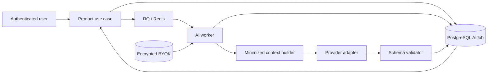

# AI Data Flow and Threat Model

## Scope

This document joins the backend AI contracts into one trust-boundary view. It describes the
foundation delivered in Phase 2; it does not authorize a public AI feature by itself.

## Data Flow

1. The product use case authenticates the user and retrieves matter data scoped by `firm_id` and
   `user_id`.
1. It creates an `AIJob` containing correlation, provider, model, function and schema versions, but
   no prompt, credential or document text.
1. RQ/Redis receives only the catalogued handler and opaque `execution_id`.
1. The worker reloads the tenant-scoped job and data from PostgreSQL, decrypts the user's BYOK key
   in memory, and builds context through `build_minimized_ai_context`.
1. The provider receives only the sealed `MinimizedAIContext`. Provider text remains untrusted.
1. `validate_ai_output` parses the complete response against the function's Pydantic schema and
   returns a sealed `ValidatedAIOutput`.
1. `AIJobsService.succeed` verifies the schema version and persists a defensive copy of validated
   JSON. Logs and metrics contain operational metadata only.

## Trust Boundaries

| Boundary                      | Untrusted input                   | Required control                                                                                                    |
| ----------------------------- | --------------------------------- | ------------------------------------------------------------------------------------------------------------------- |
| Browser to API                | identity claims, request data     | authentication, tenant-scoped authorization, input schemas                                                          |
| PostgreSQL to worker          | mutable product/document data     | reload by job `firm_id` and `user_id`; explicit allowlist                                                           |
| Application to Redis          | producer-controlled job command   | catalogued handler, JSON serializer, opaque execution ID only                                                       |
| Stored credential to provider | encrypted secret at rest          | production key wiring, scoped lookup, decrypt only in memory                                                        |
| Document/context to model     | legal and user-authored text      | size/field minimization now; `SEC-004` before real document workflows                                               |
| Provider to application       | arbitrary text and malformed JSON | closed error taxonomy and sealed schema validation result                                                           |
| Runtime to logs/metrics       | correlation and failure metadata  | allowlisted fields and content-free context/output representations; no prompts, documents, responses or credentials |

## Threats and Controls

| Threat                          | Current control                                                                               | Residual risk / next gate                                                                                         |
| ------------------------------- | --------------------------------------------------------------------------------------------- | ----------------------------------------------------------------------------------------------------------------- |
| Cross-firm or cross-user access | every `AIJob` read and mutation requires both IDs; context must be loaded with the same scope | negative multi-user tests remain mandatory per feature                                                            |
| Credential disclosure           | AES-GCM at rest, keys omitted from API and logs, provider headers only                        | operational key rotation and incident procedures remain deployment responsibilities                               |
| Sensitive data in Redis         | JSON payload contains only `execution_id`; deterministic catalogued jobs                      | real handlers must preserve this boundary                                                                         |
| Context over-collection         | sealed builder requires authorized and necessary fields and bounded payloads                  | product allowlists must be reviewed per function                                                                  |
| Forged validation marker        | `MinimizedAIContext` and `ValidatedAIOutput` reject direct construction                       | Python process memory is trusted application code; unsafe reflection is outside the boundary                      |
| Mutating a validated result     | callers receive a defensive copy and persistence receives a fresh copy                        | schemas still need `extra="forbid"` and function-specific constraints                                             |
| Provider error/content leakage  | normalized errors, redacted logs and content-free metrics                                     | provider SDK/transport changes require contract tests                                                             |
| Prompt injection in documents   | context is minimized and delimited                                                            | unresolved: `SEC-004` must separate trusted instructions from untrusted document data and prohibit tool execution |
| Autonomous legal action         | no Phase 2 handler or public AI workflow performs actions                                     | `LEGAL-002A` is required before user-facing results                                                               |

## Release Gates

Phase 2 supplies internal infrastructure, not a production legal AI workflow. Before enabling the
first document-backed function:

1. complete `SEC-004`;
1. apply `LEGAL-002A`;
1. define a closed schema and reviewed context allowlist for that function;
1. register and test a real RQ handler that reconstructs scope from PostgreSQL;
1. add negative multi-user, prompt-injection and redaction tests.

Canonical detailed contracts are:

- `../operations/ai_job_lifecycle.md`
- `../operations/rq_ai_queue.md`
- `../operations/ai_context_minimization.md`
- `../operations/structured_ai_outputs.md`
- `../operations/ai_provider_errors.md`
- `../operations/streaming_observability.md`
- `../operations/ai_metrics.md`
