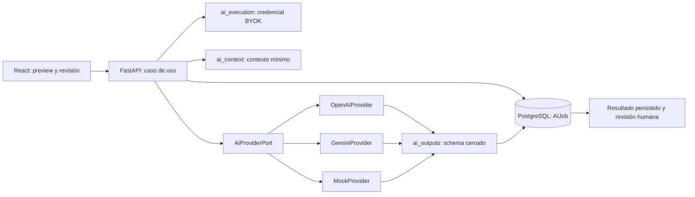

# Arquitectura de integración de IA

## Vista general

## Responsabilidades

| Componente           | Responsabilidad                                               | No debe poseer                                |
| -------------------- | ------------------------------------------------------------- | --------------------------------------------- |
| Caso de uso          | autorización, preview firmado, versiones y orquestación       | SDK, secreto o parsing informal               |
| `ai_execution`       | resolver una credencial BYOK cifrada y construir el adaptador | resultado o contexto legal                    |
| `AiProviderPort`     | contrato neutral de generación                                | tenant, persistencia o política de producto   |
| Adaptadores          | SDK oficial, timeout y traducción de errores                  | retries de negocio o credenciales persistidas |
| `MinimizedAIContext` | intersección de campos autorizados y necesarios               | concesión de autorización                     |
| `AIJob`              | estado, correlación, versiones y resultado validado           | prompt, documento o API key                   |
| `ValidatedAIOutput`  | gate de schema y copia defensiva                              | reparación silenciosa de respuestas           |

## Flujo y límites de confianza

1. El frontend solicita un preview y presenta fuentes, proveedor, modelo y costo BYOK estimado.
1. El backend liga esos datos a un token HMAC; una mutación de las fuentes invalida la ejecución.
1. El caso de uso recupera datos por `firm_id`, construye un contexto sellado y registra un `AIJob`.
1. `ai_execution` descifra la clave sólo en memoria y entrega un adaptador detrás del puerto común.
1. El adaptador separa instrucción confiable de datos no confiables y deshabilita herramientas.
1. La respuesta externa atraviesa el schema cerrado antes de persistirse o mostrarse.
1. El usuario revisa y acepta antes de convertir el resultado en una acción explícita.

Los límites completos, amenazas y controles están en
[`ai_data_flow_threat_model.md`](ai_data_flow_threat_model.md). La cola RQ conserva un límite
adicional: sólo puede transportar un `execution_id`; los flujos actuales síncronos conservan el
mismo lifecycle persistente y la misma taxonomía.

## Extensión segura

Una función nueva debe declarar identificador estable, instrucción y schema versionados, allowlist
de contexto, límites, preview, pruebas negativas multiusuario, casos de salida inválida y revisión
humana. Agregar herramientas, navegación o acciones autónomas requiere un threat model nuevo.
